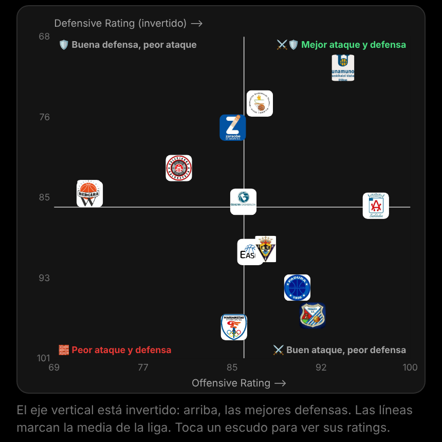
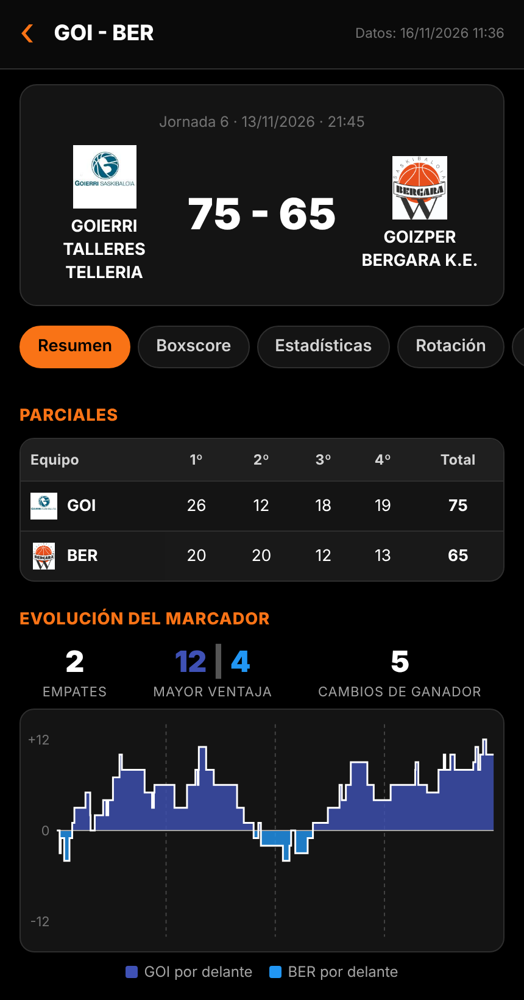
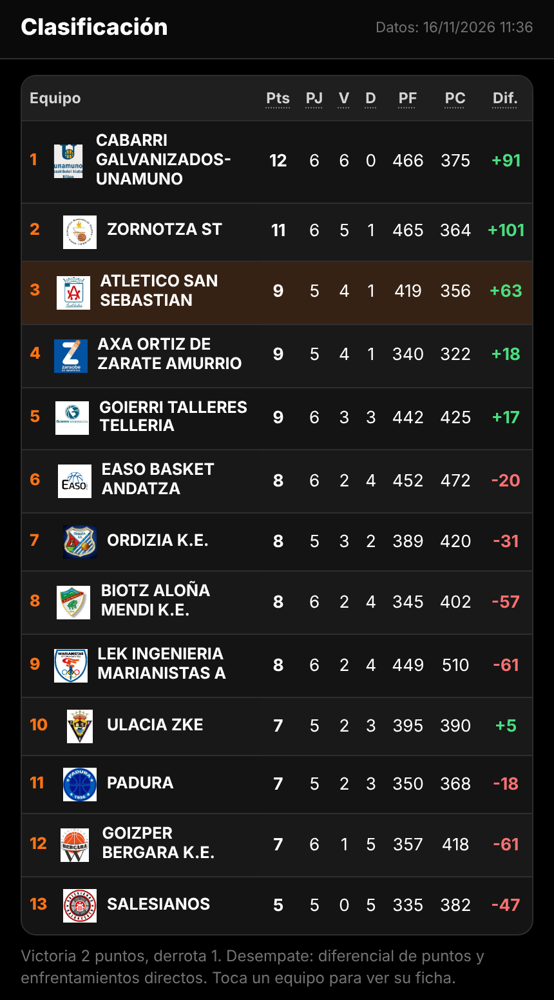

# Analítica de la Segunda Nacional Masculino 2026-27

Aplicación de estadística avanzada y scouting de una liga de baloncesto amateur: recoge los datos jugada a jugada de todos los partidos, los guarda en una base de datos propia y los convierte en métricas, gráficos e informes que un cuerpo técnico puede consultar desde el móvil.

**Estado:** en uso. El cuerpo técnico del Atlético San Sebastián la utiliza para preparar los partidos de la temporada 2026-27, y se actualiza después de cada jornada.

## Qué pregunta responde

En una liga amateur no hay estadística avanzada: solo el acta y el marcador. Esta app responde a preguntas como:

- ¿Qué equipos atacan y defienden mejor si quitamos el efecto del ritmo de juego?
- ¿Qué quintetos y qué rotaciones funcionan mejor?
- ¿Cómo rinde cada jugador y qué impacto tiene en el equipo cuando está en pista?
- En el equipo propio, ¿qué sistemas y tipos de jugada generan más puntos por posesión, y cómo nos defienden el bloqueo directo?

## De dónde salen los datos

1. **Play-by-play de la liga.** La web de la Federación Vasca de Baloncesto muestra las estadísticas de los partidos a través de un servicio externo (`msstats.optimalwayconsulting.com`). El código descarga de ahí, en formato JSON, el registro de cada partido: cada tiro, rebote, asistencia, pérdida, falta y cambio, con el minuto y el marcador. Son las mismas estadísticas que la federación muestra públicamente en su web. Se usan solo para análisis deportivo y no se redistribuyen.
2. **Etiquetado propio.** Después de cada partido del equipo propio, cada posesión se etiqueta a mano con una segunda app: tipo de jugada (playtype), sistema, defensa del bloqueo directo, tipo de defensa y posición de cada tiro en la pista.

**Este repositorio no incluye datos:** ni la base de datos, ni nombres o fotos de jugadores, ni el scouting del club. Las capturas solo muestran información de equipos.

## Qué se hace con ellos

1. **Recogida:** `scripts/actualizador_automatico.py` lee la lista de partidos, descarga los que faltan y los carga en SQLite.
2. **Modelo de datos:** `scripts/alimentar_bd.py` crea una base de datos relacional diseñada para el proyecto, con siete tablas: equipos, jugadores, partidos, convocatorias, play-by-play y etiquetado propio de ataque y de defensa.
3. **Limpieza y reconstrucción:** se normalizan nombres y duplicados, y a partir de los cambios se reconstruyen los cinco jugadores en pista en cada jugada. Así se pueden analizar quintetos, minutos y On/Off.
4. **Métricas:** posesiones, ritmo, Offensive, Defensive y Net Rating, eFG%, TS%, REB%, USG%, puntos por posesión según el tipo de jugada, rendimiento por cuartos y ratings de jugador basados en percentiles.
5. **Visualización:** una app de Streamlit (`scripts/app.py`) para el ordenador y una versión ligera que se instala en el móvil (`app_movil/`, publicada en Vercel). `scripts/exportar_movil.py` reutiliza los mismos cálculos, para que las dos apps den los mismos números.

## Qué sale

**Mapa de eficiencia de la liga.** Cada escudo es un equipo: a la derecha, mejor ataque; arriba, mejor defensa.



> Tras 6 jornadas, el Atlético San Sebastián tiene el mejor ataque de la liga (96,8 puntos por cada 100 posesiones). El líder, Cabarri, se apoya en la defensa: es el equipo que menos puntos recibe (71,1 por 100 posesiones) y el que tiene el mejor balance (+22,9).

**Resumen de partido.** Parciales y evolución del marcador jugada a jugada.



**Clasificación**, calculada directamente a partir de los partidos guardados en la base de datos.



La app incluye además boxscores, rotaciones, análisis de quintetos, fichas de equipo y de jugador, rankings y el scouting propio, que en las capturas no aparecen porque llevan nombres de jugadores.

## Herramientas

- **Python:** pandas, NumPy, requests y sqlite3
- **Base de datos:** SQLite
- **Visualización y apps:** Streamlit, Plotly, Altair
- **App móvil:** HTML, CSS y JavaScript (PWA), publicada en Vercel
- **Desarrollo:** VS Code y GitHub. Programado con ayuda de asistentes de IA (Claude y Gemini).

## Cómo ejecutarlo

Requiere Python 3.12 o superior.

```bash
pip install -r requirements.txt
cp partidos_a_procesar.ejemplo.txt partidos_a_procesar.txt
python scripts/actualizador_automatico.py   # descarga los partidos y crea mi_liga.db
streamlit run scripts/app.py                # abre la app en el navegador
```

`partidos_a_procesar.txt` tiene una línea por partido, con el identificador del partido y la jornada. El etiquetador del equipo propio se abre aparte, con `streamlit run scripts/etiquetador.py --server.port 8502`. Todos los comandos se ejecutan desde la raíz del repositorio, donde se guardan la base de datos y la configuración.

---

Erlaitz Pagola · Máster en Ciencia de Datos e IA (EBIS) · Doble Grado en ADE y Economía (UPV/EHU)
